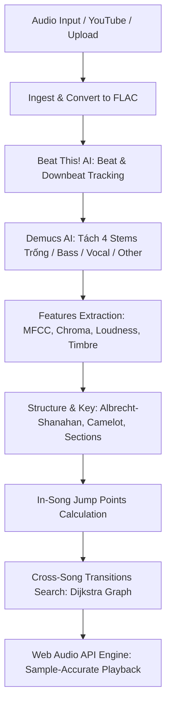

# Mash ∞ Loop — Tài liệu Kỹ thuật & Hướng dẫn Vận hành

Tài liệu này cung cấp hướng dẫn toàn diện về kiến trúc, cơ chế hoạt động, các phương thức cài đặt và vận hành ứng dụng **Mash ∞ Loop**.

---

## Mục lục
1. [Giới thiệu tổng quan](#1-giới-thiệu-tổng-quan)
2. [Kiến trúc hệ thống & Pipeline AI/DSP](#2-kiến-trúc-hệ-thống--pipeline-aidsp)
3. [Cấu trúc mã nguồn](#3-cấu-trúc-mã-nguồn)
4. [Hướng dẫn chạy trực tiếp (Native Run)](#4-hướng-dẫn-chạy-trực-tiếp-native-run)
   - [Yêu cầu tiên quyết](#yêu-cầu-tiên-quyết)
   - [Trên macOS / Linux](#trên-macos--linux)
   - [Trên Windows](#trên-windows)
   - [Sử dụng giao diện dòng lệnh (CLI)](#sử-dụng-giao-diện-dòng-lệnh-cli)
5. [Hướng dẫn chạy bằng Docker & Docker Compose](#5-hướng-dẫn-chạy-bằng-docker--docker-compose)
   - [Dùng Docker Compose (Khuyên dùng)](#dùng-docker-compose-khuyên-dùng)
   - [Dùng Docker CLI thủ công](#dùng-docker-cli-thủ-công)
   - [Hỗ trợ GPU NVIDIA (CUDA)](#hỗ-trợ-gpu-nvidia-cuda)
6. [Cấu hình biến môi trường](#6-cấu-hình-biến-môi-trường)
7. [Xử lý sự cố thường gặp (Troubleshooting)](#7-xử-lý-sự-cố-thường-gặp-troubleshooting)

---

## 1. Giới thiệu tổng quan

**Mash ∞ Loop** là ứng dụng DJ thông minh và lặp vô tận (endless jukebox):
- **Lặp vô tận trong một bài (In-song jumps):** Tự động dò tìm các beat tương đồng về hòa âm, âm sắc và năng lượng để tạo các điểm nhảy liền mạch mà người nghe không nhận ra bài hát đã lặp.
- **Nối các bài hát như một DJ (Cross-song mashup):** Tìm điểm giao giữa các bài hát khác nhau để chuyển bài thông minh với **7 kiểu nối bài**:
  - *Nối thẳng:* Hai đoạn giống hệt nhau, không nhận ra đã đổi bài.
  - *Drop:* Chuyển đúng phách đầu câu nhạc mới khi cùng groove/cường độ.
  - *Blend:* Khóa nhịp từng beat, đổi dải bass ở giữa (hỗ trợ lệch tempo tới 12% và nhịp đôi 70 ↔ 140).
  - *Crossfade dài:* Bộ lọc âm thanh 5-11 giây (bài cũ tối dần, bài mới sáng dần).
  - *Echo:* Bài cũ tan thành tiếng vọng ở cuối câu hát.
  - *Phanh đĩa & Cuộn nhịp:* Hiệu ứng đột ngột kiểu đĩa vinyl.
- **Nắn tempo (Tempo bending):** Tăng/giảm tốc mượt mà 16 beat trước điểm nối, sau đó trượt về tốc độ gốc.
- **Nhận diện giọng hát (Vocal-aware):** Không nhảy đổi giọng ca sĩ giữa câu hoặc cắt ngang câu hát.

---

## 2. Kiến trúc hệ thống & Pipeline AI/DSP

Mỗi bài hát khi thêm vào hệ thống được xử lý qua pipeline phân tích âm thanh (`loopbox/analysis/`):



1. **Dò nhịp (`beats.py`):** Dùng model **Beat This!** phát hiện beat và downbeat theo lưới 20ms, sau đó kéo về đỉnh onset thực tế (sai số chỉ ~0.7ms).
2. **Tách nguồn âm (`models.py`):** Dùng model **Demucs** (`htdemucs`) tách thành 4 dải: Trống (Drums), Bass, Giọng hát (Vocals) và Nhạc cụ khác (Other).
3. **Trích xuất đặc trưng (`features.py`):** Phân tích hòa âm (chroma không trống), âm sắc (MFCC), độ lớn (LUFS), nhịp điệu nội bộ beat và cao độ giọng hát.
4. **Cấu trúc & Mood (`structure.py`, `mood.py`):** Ước tính tempo, tông (key profile Albrecht-Shanahan và vòng Camelot DJ), câu nhạc 4 ô nhịp và tọa độ cảm xúc (Energy & Valence).
5. **Tìm điểm nhảy (`jumps.py`):** Tìm các cặp beat khớp trong cửa sổ 8 beat, cùng vị trí câu nhạc, áp dụng crossfade 12ms - 60ms.
6. **Ma trận nối bài (`transitions.py`):** Tính toán và lưu cache các điểm nối giữa từng cặp bài hát để tái sử dụng ngay lập tức cho các lần sau.

---

## 3. Cấu trúc mã nguồn

```
mashloop/
├── loopbox/                 # Backend cốt lõi (Python + FastAPI)
│   ├── analysis/            # Pipeline AI & DSP xử lý âm thanh
│   │   ├── beats.py         # Dò beat & downbeat (Beat This!)
│   │   ├── models.py        # Quản lý tải model Beat This & Demucs
│   │   ├── features.py      # Trích xuất MFCC, Chroma, Loudness
│   │   ├── structure.py     # Phân tích nhịp, tông nhạc, câu nhạc
│   │   ├── jumps.py         # Điểm nhảy lặp vô tận trong bài
│   │   ├── transitions.py   # Điểm nối và thuật toán chuyển bài (Dijkstra)
│   │   └── mood.py          # Ước lượng năng lượng & sắc thái bài hát
│   ├── audio.py             # Xử lý tệp audio, chuẩn hóa LUFS
│   ├── cli.py               # Giao diện dòng lệnh (loopbox CLI)
│   ├── config.py            # Cấu hình hệ thống & biến môi trường
│   ├── download.py          # Tải nhạc từ YouTube, SoundCloud, Zing MP3...
│   ├── ingest.py            # Quản lý hàng đợi và pipeline phân tích
│   ├── library.py           # Quản lý metadata bài hát & kho lưu trữ
│   ├── server.py            # FastAPI REST server & static file host
│   ├── worker.py            # Tiến trình phân tích đa luồng
│   └── sessions.py          # Quản lý phiên làm việc đa người dùng
├── web/                     # Frontend thuần (Vanilla HTML/CSS/JS)
│   ├── index.html           # Giao diện ứng dụng chính
│   ├── css/                 # Phong cách hiển thị, theme tối & màu mood
│   └── js/                  # Logic phát nhạc & trực quan hóa
│       ├── engine.js        # Web Audio API engine
│       ├── player.js        # Bộ điều khiển playback, crossfade, scheduling
│       ├── viz.js           # Canvas vẽ dấu ∞ và phổ âm thanh
│       └── graph.js         # Đồ thị tìm đường chuyển bài
├── tools/                   # Công cụ mô phỏng phát nhạc & test E2E
├── deploy/                  # Script triển khai Linux server (systemd, HAProxy)
├── data/                    # Thư mục chứa bài hát, cache phân tích, điểm nhảy
├── Dockerfile               # File build Docker image
├── docker-compose.yml       # Cấu hình chạy nhanh bằng Docker Compose
├── run.sh                   # Script khởi động nhanh cho macOS / Linux
├── run.ps1                  # Script khởi động nhanh cho Windows
└── requirements.txt         # Danh sách thư viện Python cần thiết
```

---

## 4. Hướng dẫn chạy trực tiếp (Native Run)

### Yêu cầu tiên quyết
- **Python:** Phiên bản `3.11` trở lên.
- **ffmpeg:** Đã cài đặt và có trong biến môi trường `PATH`.
- **Node.js:** Phiên bản `20+` (yt-dlp yêu cầu JS runtime để giải mã YouTube player).

### Trên macOS / Linux

1. **Tạo virtual environment và kích hoạt:**
   ```bash
   python3.11 -m venv .venv
   source .venv/bin/activate
   ```

2. **Cài đặt thư viện:**
   ```bash
   pip install --upgrade pip
   pip install torch torchaudio
   pip install --no-deps beat-this demucs
   pip install -r requirements.txt
   ```

3. **Khởi chạy ứng dụng:**
   - Dùng script có sẵn:
     ```bash
     ./run.sh
     ```
   - Hoặc chạy lệnh server trực tiếp:
     ```bash
     python -m loopbox.server --open
     ```

### Trên Windows

Mở PowerShell tại thư mục dự án:
```powershell
python -m venv .venv
.venv\Scripts\pip install torch==2.6.0 torchaudio==2.6.0 --index-url https://download.pytorch.org/whl/cu124
.venv\Scripts\pip install --no-deps beat-this demucs
.venv\Scripts\pip install -r requirements.txt
.\run.ps1
```

### Sử dụng giao diện dòng lệnh (CLI)

Bạn có thể quản lý thư viện nhạc trực tiếp từ terminal mà không cần mở trình duyệt:

```bash
# Thêm bài hát từ link YouTube hoặc từ khóa tìm kiếm:
python -m loopbox.cli add "https://www.youtube.com/watch?v=..."
python -m loopbox.cli add "Daft Punk Get Lucky"

# Xem danh sách bài hát trong thư viện kèm BPM, Key Camelot:
python -m loopbox.cli list

# Tính toán lại ma trận nối giữa tất cả các bài hát:
python -m loopbox.cli relink

# Tính toán lại điểm nhảy trong bài từ features đã lưu (rất nhanh, không cần GPU):
python -m loopbox.cli rejump
```

---

## 5. Hướng dẫn chạy bằng Docker & Docker Compose

Docker đóng gói toàn bộ môi trường (bao gồm Python 3.11, ffmpeg và Node.js 20), giúp chạy trên bất kỳ máy nào mà không lo xung đột phần mềm.

### Dùng Docker Compose (Khuyên dùng)

1. **Khởi động server:**
   ```bash
   docker-compose up -d --build
   ```
2. **Kiểm tra logs:**
   ```bash
   docker-compose logs -f
   ```
3. **Dừng server:**
   ```bash
   docker-compose down
   ```

Truy cập: **`http://localhost:8765`**.

### Dùng Docker CLI thủ công

1. **Build Docker Image:**
   ```bash
   docker build -t mashloop:latest .
   ```

2. **Chạy container (Mount volume và kết nối vào network pingvin-net):**
   ```bash
   docker run -d \
     --name mashloop \
     --network pingvin-net \
     -p 8765:8765 \
     -v /Users/itsw/work/mashloop/data:/app/data \
     mashloop:latest
   ```

> [!TIP]
> - Cờ `--network pingvin-net` giúp container cùng chung mạng với `cloudflared-tunnel`, cho phép Cloudflare Tunnel trỏ trực tiếp đến URL: `http://mashloop:8765`.
> - Việc mount `-v /Users/itsw/work/mashloop/data:/app/data` đảm bảo các bài hát đã tải, kết quả phân tích và model AI weights không bị mất khi container restart hoặc được tạo mới. Image đặt `TORCH_HOME=/app/data/torch` và `HF_HOME=/app/data/huggingface`, nên model Beat This! (`data/torch/`) và Demucs (`data/huggingface/`) nằm trên máy host và chỉ tải một lần.

### Hỗ trợ GPU NVIDIA (CUDA)

Nếu chạy Docker trên máy Linux có GPU NVIDIA:
1. Khi build, truyền thêm cờ build-arg CUDA:
   ```bash
   docker build --build-arg TORCH_INDEX=https://download.pytorch.org/whl/cu124 -t mashloop:latest .
   ```
2. Trong `docker-compose.yml`, mở comment phần `deploy.resources.reservations.devices` để cấp quyền truy cập GPU cho container.

---

## 6. Cấu hình biến môi trường

Các biến môi trường có thể được định cấu hình trong file `docker-compose.yml` hoặc truyền khi khởi chạy:

| Biến môi trường | Mặc định | Mô tả |
|---|---|---|
| `MASHLOOP_HOST` | `127.0.0.1` (`0.0.0.0` trong Docker) | Địa chỉ IP lắng nghe của server |
| `MASHLOOP_PORT` | `8765` | Cổng dịch vụ |
| `MASHLOOP_DATA` | `./data` (`/app/data` trong Docker) | Đường dẫn lưu trữ thư viện nhạc & cache |
| `MASHLOOP_MULTIUSER` | `0` | Đặt `1` để chuyển sang chế độ nhiều người dùng (mỗi phiên có thư viện riêng) |
| `MASHLOOP_ANALYSIS_WORKERS` | `1` | Số bài hát phân tích song song cùng lúc |
| `MASHLOOP_LINK_WORKERS` | `1` | Số tiến trình tính toán điểm nối bài |
| `MASHLOOP_WORKER_THREADS` | `4` | Số luồng CPU trên mỗi worker process |
| `MASHLOOP_MAX_STORE_GB` | `0` (không giới hạn) | Dung lượng tối đa của kho nhạc trước khi tự xóa bài cũ |
| `MASHLOOP_MAX_SESSION_TRACKS` | `60` | Số bài hát tối đa trong một thư viện phiên |
| `MASHLOOP_MAX_DURATION_S` | `900` (15 phút) | Độ dài tối đa của một bài hát cho phép phân tích |
| `MASHLOOP_JS_RUNTIME` | `node` | Runtime JavaScript cho yt-dlp (`node` hoặc `deno`) |
| `TORCH_HOME` | `~/.cache/torch` (`/app/data/torch` trong Docker) | Nơi torch hub lưu model Beat This! |
| `HF_HOME` | `~/.cache/huggingface` (`/app/data/huggingface` trong Docker) | Nơi Hugging Face lưu model Demucs (`htdemucs`) |

---

## 7. Xử lý sự cố thường gặp (Troubleshooting)

### 1. Lỗi cổng 8765 đã bị chiếm (`Address already in use`)
- **Cách khắc phục:**
  - Nếu chạy native, dùng `./run.sh` (script sẽ tự động tìm PID đang chiếm cổng 8765 và tắt nó).
  - Hoặc giải phóng thủ công:
    ```bash
    kill -9 $(lsof -ti :8765)
    ```

### 2. yt-dlp báo lỗi khi tải video YouTube
- **Nguyên nhân:** YouTube thường xuyên cập nhật thuật toán bot detection challenge.
- **Cách khắc phục:** Đảm bảo `node` có trong PATH (`node -v` trả về phiên bản ≥ 20) và cập nhật phiên bản mới nhất của yt-dlp:
  ```bash
  .venv/bin/pip install --upgrade yt-dlp
  ```

### 3. Lần đầu thêm bài hát phân tích rất lâu
- **Nguyên nhân:** Lần đầu tiên chạy, hệ thống cần tải mô hình AI `Beat This!` và `htdemucs` (~160MB) về máy: Beat This! vào cache của torch (`~/.cache/torch`), Demucs vào cache của Hugging Face (`~/.cache/huggingface`); chạy bằng Docker thì cả hai nằm trong `data/torch` và `data/huggingface`. Model chỉ tải một lần.
- **Cách khắc phục:** Từ bài thứ 2 trở đi, tốc độ phân tích sẽ nhanh hơn đáng kể. Các bài hát đã phân tích một lần sẽ được lưu trữ vĩnh viễn trong `data/library/` và không bao giờ phải phân tích lại.
